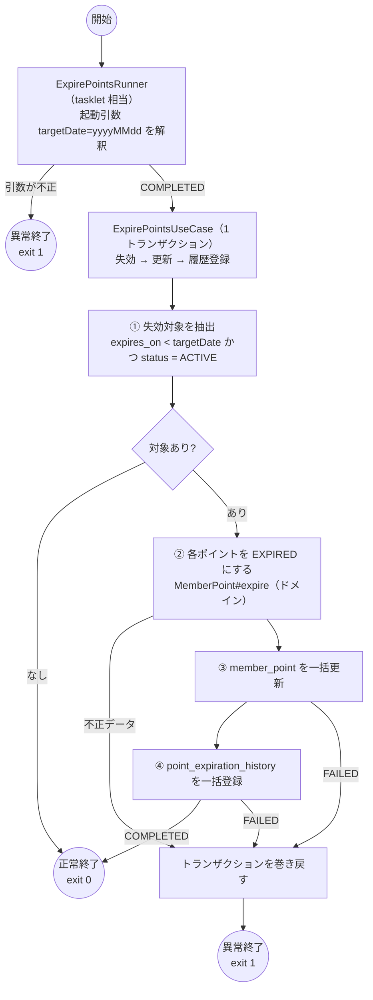

# expirePointsJob 設計図

対象仕様書: [t1-expire-points.md](t1-expire-points.md)

## 1. 判断結果: 素の Spring Boot（`ApplicationRunner`）

仕様 6「途中で失敗したとき: 最初からやり直してよい」「一時的なエラーを再試行するか: しない」、
仕様 2「二重起動を防ぐ必要があるか: ない（スケジューラが排他する）」、
仕様 3「想定件数 2,000 / 最大 20,000」より、
[batch-vs-boot.md](../../.claude/skills/spring-batch-dev/references/batch-vs-boot.md) の「素の Spring Boot で済ませてよい条件」をすべて満たすため、Spring Batch は使わない。

| 条件 | 本ジョブ | 根拠 |
|---|---|---|
| 1 トランザクションで収まる | 満たす | 最大 20,000 件（仕様 3） |
| 失敗時は最初から再実行してよい | 満たす | 仕様 6 |
| 実行履歴はスケジューラとログで足りる | 満たす | 仕様 6「スケジューラの監視に任せる」 |
| ステップ間の複雑な分岐がない | 満たす | 仕様 4 は直列の 3 手順 |

Batch を選ぶ条件（途中再開・chunk コミット・宣言的スキップ／リトライ・二重起動防止・条件分岐・並列化）には一つも当てはまらない。

## 2. 処理の流れ



## 3. ステップ

Spring Batch を使わないため Step は無く、`ApplicationRunner` が単一の処理単位（tasklet 相当）となる。

| ステップ | 種類 | Reader | Processor | Writer | 異常時 |
|---|---|---|---|---|---|
| expirePoints | tasklet 相当（`ApplicationRunner` 1 回） | `MyBatisMemberPointRepository#findExpirableAsOf`（infrastructure） | `ExpirePointsUseCase`（application）→ `MemberPoint#expire`（domain） | `MyBatisMemberPointRepository#saveExpired` / `MyBatisPointExpirationHistoryRepository#addAll`（infrastructure） | スキップ・リトライともに無し。例外はすべて送出し、トランザクションを巻き戻して exit 1 |

- **コミット単位**: ジョブ全体で 1 トランザクション（`ExpirePointsUseCase` が境界）。最大 20,000 件なので 1 トランザクションに収まる。
- **SQL の発行単位**: トランザクションは 1 つのまま、UPDATE / INSERT は 1,000 件ずつに分けて発行する（`max_allowed_packet` 対策。infrastructure 層の都合であり業務上の区切りではない）。
- **冪等性**: 対象条件が `status = 'ACTIVE'` であり、成功後は `EXPIRED` になるため、再実行しても同じ対象を二度失効させない。途中失敗時は全件巻き戻るため、履歴の重複も起きない。
- **不正データ**: ドメインの生成時に検証し、違反があれば `InvalidMemberPointException` を送出してジョブを止める（仕様 6）。

### 不正データとみなすもの

| 列 | 条件 |
|---|---|
| `id` / `member_id` | NULL、または 0 以下 |
| `points` | NULL、または 0 以下 |
| `expires_on` | NULL |
| `status` | NULL、または `ACTIVE` / `EXPIRED` 以外 |

## 4. 使うクラス

### batch

| クラス | 役割 |
|---|---|
| `ExpirePointsBatchApplication` | 起動口。`main` で終了コードを `System.exit` に渡す（コンポーネント走査の起点とするため、ルートの `com.example.expirepoints` に置く） |
| `ExpirePointsRunner` | `ApplicationRunner` + `ExitCodeGenerator`。UseCase を 1 回呼び、結果を記録する |
| `TargetDateArgument` | 起動引数 `--targetDate=yyyyMMdd` の解釈 |

### application

| クラス | 役割 |
|---|---|
| `ExpirePointsUseCase` | トランザクション境界。抽出 → 失効 → 更新 → 履歴登録を組み立てる |
| `ExpirePointsResult` | 失効件数と失効ポイント合計 |

### domain

| クラス | 役割 |
|---|---|
| `BusinessDate` | 業務日付の値オブジェクト（`yyyyMMdd` の解釈を持つ） |
| `MemberId` | 会員 ID の値オブジェクト |
| `MemberPointId` | 会員ポイント ID の値オブジェクト |
| `PointAmount` | ポイント数の値オブジェクト（1 以上） |
| `PointStatus` | `ACTIVE` / `EXPIRED` |
| `MemberPoint` | 会員ポイントのエンティティ。失効可否の判断と `expire` を持つ |
| `PointExpirationHistory` | 失効履歴のエンティティ |
| `InvalidMemberPointException` | 不正データ |
| `PointNotExpirableException` | 失効できないポイントへの `expire` |
| `MemberPointRepository` | 抽出と更新のインタフェース |
| `PointExpirationHistoryRepository` | 履歴登録のインタフェース |

### infrastructure

| クラス | 役割 |
|---|---|
| `MyBatisMemberPointRepository` | `MemberPointRepository` の実装。DTO ⇄ ドメインの変換 |
| `MyBatisPointExpirationHistoryRepository` | `PointExpirationHistoryRepository` の実装 |
| `MemberPointMapper` / `MemberPointMapper.xml` | `member_point` の SELECT / UPDATE |
| `PointExpirationHistoryMapper` / `PointExpirationHistoryMapper.xml` | `point_expiration_history` の INSERT |
| `MemberPointRecord` | `member_point` のテーブル形 DTO |
| `PointExpirationHistoryRecord` | `point_expiration_history` のテーブル形 DTO |

## 5. 起動

```
java -jar expire-points-batch.jar --targetDate=20261019
```

終了コード: 0 = 正常終了、1 = 異常終了（引数不正、不正データ、DB 障害）。
