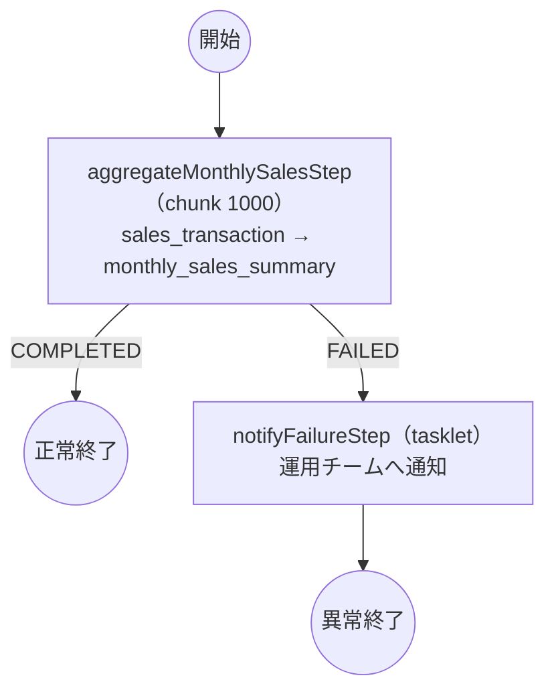

# monthlySalesSummaryJob 設計図

対象仕様書: [t2-monthly-sales.md](t2-monthly-sales.md)

## 1. 判断結果: Spring Batch を使う

| 判断条件（batch-vs-boot.md） | 仕様の根拠 |
|---|---|
| 途中からの再実行が必要 | 6.「失敗した所から再開したい（最初からだと期限に間に合わない）」 |
| 件数が多く、一定件数ごとにコミットしたい | 3. sales_transaction 3,000,000 / 最大 8,000,000 件 |
| スキップ・リトライの方針を宣言的に持ちたい | 6.「不正データは飛ばして続ける。上限 1,000 件」「デッドロックのみ 3 回」 |
| 実行履歴と二重起動防止を DB で管理したい | 2.「同じ対象年月で二度走らせない」 |

→ 四条件に明確に当てはまるため Spring Batch を採用する。二重起動防止は `targetMonth` を識別用ジョブパラメータとし、Spring Batch の JobInstance 一意制約に任せる（自前の排他表は作らない）。

## 2. 処理の流れ



## 3. ステップ

| ステップ | 種類 | Reader | Processor | Writer | 異常時 |
|---|---|---|---|---|---|
| aggregateMonthlySalesStep | chunk 1000 | `SalesTransactionItemReader`（infrastructure） | `SalesTransactionItemProcessor`（batch）→ `SummarizeSalesTransactionUseCase` | `MonthlySalesSummaryItemWriter`（infrastructure） | 不正データは 1,000 件までスキップし取引 ID を WARN ログ出力／デッドロックは 3 回まで再試行／上限超過で FAILED |
| notifyFailureStep | tasklet | ― | `NotifyJobFailureUseCase` | ― | ― |

### 再開の仕組み

- Reader は `MyBatisCursorItemReader` を包み、`ORDER BY transaction_date, transaction_id` の一意かつ決定的な順序で読む。Spring Batch が `ExecutionContext` に読み込み済み件数を保存するため、再開時は同じ順序で読み飛ばして続きから処理する。
- Writer は chunk 単位のトランザクションで「既存の集計行に加算、無ければ新規登録」（`INSERT ... ON DUPLICATE KEY UPDATE`）を行う。失敗した chunk はロールバックされるので、再開時に二重計上は起きない。
- ステップは単一スレッドで動かす（並列化すると読み込み順序と件数による再開が成立しない）。

### スキップ・リトライ

| 事象 | 扱い |
|---|---|
| 不正データ（`InvalidSalesTransactionException`） | スキップ。上限 1,000 件。`SkippedSalesTransactionLogger` が取引 ID と理由を WARN で出力 |
| DB デッドロック（`CannotAcquireLockException`） | chunk 単位で、最初の試行に加えて 3 回まで再試行する |
| 上記以外の例外 | 即座にステップを FAILED にする |

MySQL のデッドロックは `SQLState 40001` の `SQLTransactionRollbackException` として返り、Spring はこれを
`CannotAcquireLockException` に翻訳する。古い `DeadlockLoserDataAccessException` は Spring Framework 7 で
非推奨になり、もはや送出されないため、これを指定しても再試行は働かない。
`retryLimit(3)` は Spring の `RetryPolicy` の `maxRetries` に渡るので、最初の試行を除いた再試行回数である。

不正データの判定（`SalesTransaction` の生成時に検査）:
取引 ID・店舗 ID・商品 ID が空、取引日が無い、区分が `SALE` / `RETURN` 以外、金額または数量が負。
加えて、取引日が対象年月の外にある場合も不正として扱う（`SummarizeSalesTransactionUseCase`）。

## 4. 業務ルールの置き場所

- 返品（`type = 'RETURN'`）の符号反転は `TransactionType#subtracts` と `SalesTransaction#signedAmount` / `#signedQuantity`（domain）に置く。
- 店舗・商品ごとの合算は `MonthlySalesSummary#add` と `MonthlySalesSummaryMerger`（domain）に置く。SQL では合算しない。
- Reader は「対象年月の取引明細に絞る」ことだけを SQL で行う。

## 5. クラス一覧

### 起動口

| クラス | 役割 |
|---|---|
| `MonthlySalesBatchApplication` | Spring Boot の起動口。終了コードを返して終わる |

### batch

| クラス | 役割 |
|---|---|
| `MonthlySalesSummaryJobConfig` | Job と 2 つの Step の定義 |
| `TargetMonthJobParametersValidator` | 起動引数 `targetMonth=yyyyMM` の検査 |
| `SalesTransactionItemProcessor` | `SummarizeSalesTransactionUseCase` を呼ぶだけ |
| `SkippedSalesTransactionLogger` | スキップした取引 ID のログ出力（`SkipListener`） |
| `NotifyFailureTasklet` | `NotifyJobFailureUseCase` を呼ぶだけ |
| `MonthlySalesJobProperties` | chunk 件数・スキップ上限・リトライ回数の設定 |

### application

| クラス | 役割 |
|---|---|
| `SummarizeSalesTransactionUseCase` | 取引 1 件を、その取引だけの月次集計（差分）に変換する |
| `NotifyJobFailureUseCase` | 失敗したジョブの情報を運用チームへ通知する |

### domain

| クラス | 役割 |
|---|---|
| `shared.TargetMonth` | 対象年月（`yyyyMM`）。月初日と翌月初日を導く |
| `shared.StoreId` / `shared.ProductId` | 店舗 ID / 商品 ID |
| `shared.Money` / `shared.Quantity` | 金額 / 数量。加算と符号反転 |
| `sales.SalesTransaction` | 取引明細（エンティティ）。生成時に不正データを弾く |
| `sales.SalesTransactionId` | 取引 ID |
| `sales.TransactionType` | `SALE` / `RETURN`。`subtracts()` が符号を決める |
| `sales.InvalidSalesTransactionException` | 不正データ。取引 ID と理由を持つ |
| `summary.MonthlySalesSummary` | 店舗・商品・対象年月ごとの集計（エンティティ） |
| `summary.MonthlySalesKey` | 集計の識別子（対象年月・店舗・商品） |
| `summary.MonthlySalesSummaryMerger` | 同じ識別子の集計を畳み込むドメインサービス |
| `summary.MonthlySalesSummaryRepository` | 集計の加算登録（インタフェース） |
| `notification.OperationTeamNotifier` | 運用チームへの通知（インタフェース） |
| `notification.JobFailureNotice` | 通知の内容 |

### infrastructure

| クラス | 役割 |
|---|---|
| `MonthlySalesInfrastructureConfig` | Reader / Writer の Bean 定義 |
| `sales.SalesTransactionMapper` + `SalesTransactionMapper.xml` | 対象年月の取引明細をカーソルで読む |
| `sales.SalesTransactionRow` | 取引明細のテーブル形 DTO |
| `sales.SalesTransactionItemReader` | カーソル読み込みと DTO → `SalesTransaction` 変換 |
| `summary.MonthlySalesSummaryMapper` + `MonthlySalesSummaryMapper.xml` | 集計の加算登録（`ON DUPLICATE KEY UPDATE`） |
| `summary.MonthlySalesSummaryRow` | 集計のテーブル形 DTO |
| `summary.MyBatisMonthlySalesSummaryRepository` | `MonthlySalesSummaryRepository` の実装 |
| `summary.MonthlySalesSummaryItemWriter` | chunk 内を畳み込んでリポジトリへ渡す |
| `notification.LogOperationTeamNotifier` | `OPS_ALERT` ロガーへ ERROR 出力 |

## 6. 入出力

### 入力: sales_transaction

`transaction_date >= 対象年月の月初` かつ `< 翌月の月初` で絞り、`transaction_date, transaction_id` の昇順で読む。
索引 `idx_sales_transaction_date (transaction_date, transaction_id)` により、範囲走査のまま整列済みで読めるようにする。

### 出力: monthly_sales_summary

主キー `(target_month, store_id, product_id)` に対して `INSERT ... ON DUPLICATE KEY UPDATE` で加算登録する。
DDL は [`src/main/resources/db/schema.sql`](../../src/main/resources/db/schema.sql) にある。

## 7. 起動

```
java -jar monthly-sales-batch.jar targetMonth=202509
```

`targetMonth` は識別用ジョブパラメータ。同じ値で完了済みのジョブは Spring Batch が拒否し、実行中のものがあれば二重起動が防がれる。
終了コードはスケジューラが成否を判定できるよう `ExitCodeGenerator` で返す（正常 0 / 異常 1）。
