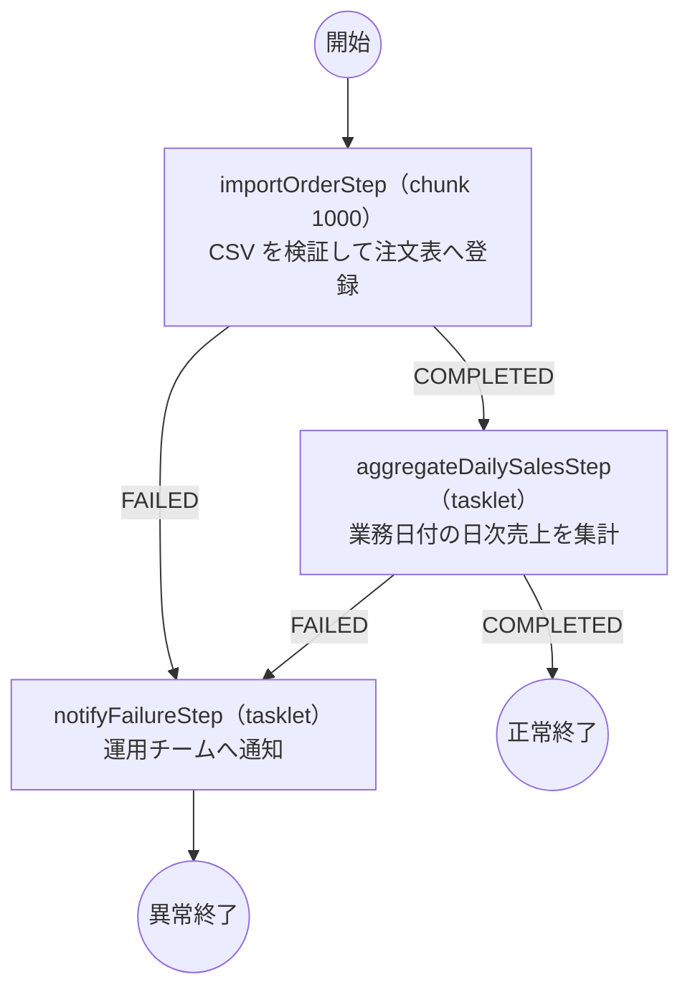

# orderImportJob 設計図

仕様書: [t3-order-import.md](t3-order-import.md)

## 1. 判断: Spring Batch を使う

| 根拠（仕様の項目） | 内容 |
|---|---|
| 6. 異常時 | 「失敗した所から再開したい」→ 途中からの再実行が必要 |
| 3. 入力 | 最大 300,000 件。1 トランザクションに収まらないため chunk 単位でコミットしたい |
| 6. 異常時 | 「不正データは飛ばして続ける。上限 100 件」→ スキップ方針を宣言的に持ちたい |
| 2. 起動 | 「二重起動を防ぐ必要がある」→ 実行履歴と二重起動防止を DB（JobRepository）で管理したい |
| 4. 処理 | 取込 → 成功なら集計 / 失敗なら通知 → 複数ステップを条件分岐でつなぐ |

素の Spring Boot で済ませてよい条件（全該当が必要）を満たさないため、Spring Batch を採用する。

## 2. 起動

- ジョブ名: `orderImportJob`
- 起動引数（ジョブパラメータ）: `targetDate=yyyyMMdd`、`inputFile=<CSV のパス>`
- 二重起動防止: JobRepository による。同じパラメータの実行中インスタンスは `JobExecutionAlreadyRunningException`、完了済みインスタンスは `JobInstanceAlreadyCompleteException` で拒否される
- 再開: 失敗した `JobExecution` を同じパラメータで再実行すると、`importOrderStep` は `FlatFileItemReader` が `ExecutionContext` に保存した読み取り位置から再開する

## 3. 処理の流れ

`notifyFailureStep` を通った場合、ジョブの終了状態は `FAILED` とする（スケジューラが失敗を検知できるようにするため）。

## 4. ステップ

| ステップ | 種類 | Reader | Processor | Writer | 異常時 |
|---|---|---|---|---|---|
| importOrderStep | chunk 1000 | `OrderCsvItemReader`（infrastructure） | `ImportOrderItemProcessor`（batch）→ `ImportOrderUseCase`（application） | `OrderItemWriter`（infrastructure）→ `OrderRepository` | 不正行は 100 件までスキップ（`InvalidOrderException`, `FlatFileParseException`）。リトライなし。101 件目で `FAILED` |
| aggregateDailySalesStep | tasklet | ― | `AggregateDailySalesTasklet`（batch）→ `AggregateDailySalesUseCase`（application） | ― | 失敗で `notifyFailureStep` へ |
| notifyFailureStep | tasklet | ― | `NotifyFailureTasklet`（batch）→ `NotifyJobFailureUseCase`（application） | ― | 完了済みでもやり直す（`allowStartIfComplete(true)`）。再開した実行がまた失敗したときにも知らせるため |

### スキップ・リトライ

- スキップ対象: `InvalidOrderException`（検証違反）、`FlatFileParseException`（CSV の桁数不足など）
- スキップ上限: 100 件。`SkipListener` でスキップした行をログに残す
- リトライ: しない（仕様 6）

### 性能

4:00 起動・7:00 期限に対し、最大 300,000 件 ÷ chunk 1000 = 300 コミット。

- 顧客・商品の存在確認は、確認した結果を infrastructure 側（`MyBatisCustomerRepository` / `MyBatisProductRepository`）で覚えておき、同じコードが現れたときの問い合わせを省く
- 日次売上の集計は `SUM` / `COUNT` を SQL で行い、注文をメモリに載せない

## 5. クラス一覧

### batch（起動口・流れ）

| クラス | 役割 |
|---|---|
| `OrderImportApplication` | `main`。web サーバは起動しない |
| `OrderImportJobConfig` | `orderImportJob` と 3 ステップの定義。流れのみを書く |
| `ImportOrderItemProcessor` | `ImportOrderUseCase` を呼ぶだけ |
| `AggregateDailySalesTasklet` | `AggregateDailySalesUseCase` を呼ぶだけ |
| `NotifyFailureTasklet` | `NotifyJobFailureUseCase` を呼ぶだけ |
| `SkippedOrderLoggingListener` | スキップした行をログに残す |
| `JobArguments` | 起動引数（`targetDate`, `inputFile`）の解釈 |

### application（ユースケース・トランザクション境界）

| クラス | 役割 |
|---|---|
| `ImportOrderUseCase` | 1 件の注文を検証する。違反は `InvalidOrderException` |
| `AggregateDailySalesUseCase` | 業務日付の注文を集計し、日次売上を登録する（`@Transactional`） |
| `NotifyJobFailureUseCase` | 失敗の通知を組み立て、`NotificationGateway` に渡す |

### domain（Spring・MyBatis・Spring Batch を import しない）

| パッケージ | クラス | 役割 |
|---|---|---|
| `domain.shared` | `BusinessDate` | 業務日付 |
| `domain.shared` | `Money` | 金額 |
| `domain.order` | `Order` | 注文エンティティ。`amount()`、`orderDate()` |
| `domain.order` | `OrderNumber` | 注文番号 |
| `domain.order` | `Quantity` | 数量。1 未満は `InvalidOrderException` |
| `domain.order` | `OrderSalesSummary` | ある業務日付の注文の件数と合計金額 |
| `domain.order` | `OrderValidator` | ドメインサービス。顧客・商品の存在を確かめる |
| `domain.order` | `InvalidOrderException` | 検証違反 |
| `domain.order` | `OrderRepository` | `saveAll`、`summarizeByOrderDate` |
| `domain.customer` | `CustomerCode`, `CustomerRepository` | 顧客コードと存在確認 |
| `domain.product` | `ProductCode`, `ProductRepository` | 商品コードと存在確認 |
| `domain.sales` | `DailySales`, `DailySalesRepository` | 日次売上 |
| `domain.notification` | `NotificationGateway`, `JobFailureNotice` | 通知の送り口（仕様 6 で指定されたインタフェース） |

### infrastructure（domain のインタフェースを実装する）

| クラス | 役割 |
|---|---|
| `OrderCsvItemReader` | `FlatFileItemReader<Order>`。CSV 行を `Order` に変換する。`@StepScope` |
| `OrderItemWriter` | `OrderRepository.saveAll` を呼ぶ |
| `MyBatisOrderRepository` / `OrderMapper` / `OrderMapper.xml` / `OrderRecord` / `OrderSalesSummaryRecord` | 注文の登録と集計 |
| `MyBatisCustomerRepository` / `CustomerMapper` / `CustomerMapper.xml` | 顧客コードの存在確認 |
| `MyBatisProductRepository` / `ProductMapper` / `ProductMapper.xml` | 商品コードの存在確認 |
| `MyBatisDailySalesRepository` / `DailySalesMapper` / `DailySalesMapper.xml` / `DailySalesRecord` | 日次売上の登録 |
| `LoggingNotificationGateway` | `NotificationGateway` の仮実装。ログに出す（仕様 6「実装は仮でよい」） |

SQL はすべて XML に書く。Mapper はテーブル形の DTO を返し、ドメインオブジェクトへの変換はリポジトリ実装（Reader の場合は Reader）の中で行う。

## 6. 出力

| 対象 | 内容 |
|---|---|
| `orders` | 取り込んだ注文を登録。注文番号が主キー。再開時の重複を避けるため upsert |
| `daily_sales` | 業務日付ごとの件数と合計金額を登録。業務日付が主キー。再実行に備え upsert |
| 通知 | 失敗時のみ `NotificationGateway` 経由 |

## 7. 仕様に書かれていなかったため置いた前提

仕様書に無く、実装のために決めた事柄である。違っていれば直す。

| 前提 | 置き場所 |
|---|---|
| CSV の注文日時の書式は `yyyy-MM-dd HH:mm:ss` | `OrderCsvItemReader.ORDERED_AT_FORMAT` |
| 区切り文字はカンマ、囲み文字は `"` | `OrderCsvItemReader`（`DelimitedLineTokenizer` の既定） |
| `targetDate` は取り込む注文が属する業務日付であり（ファイル名の日付と同じ）、集計対象は注文日時の日付が `targetDate` の注文とする | `AggregateDailySalesUseCase` |
| 集計は「今回の取り込み分」ではなく「注文表にあるその業務日付の注文すべて」を数える。再開・再実行しても結果が同じになるようにするため | `AggregateDailySalesUseCase` |
| 注文番号は注文を一意に決める | `orders` の主キー |
| MySQL は 8.0.19 以降（別名を使う `ON DUPLICATE KEY UPDATE` の記法を使うため） | `OrderMapper.xml`, `DailySalesMapper.xml` |
| Spring Batch のメタデータ表は運用側で作る（`spring.batch.jdbc.initialize-schema=never`） | `application.yml` |
