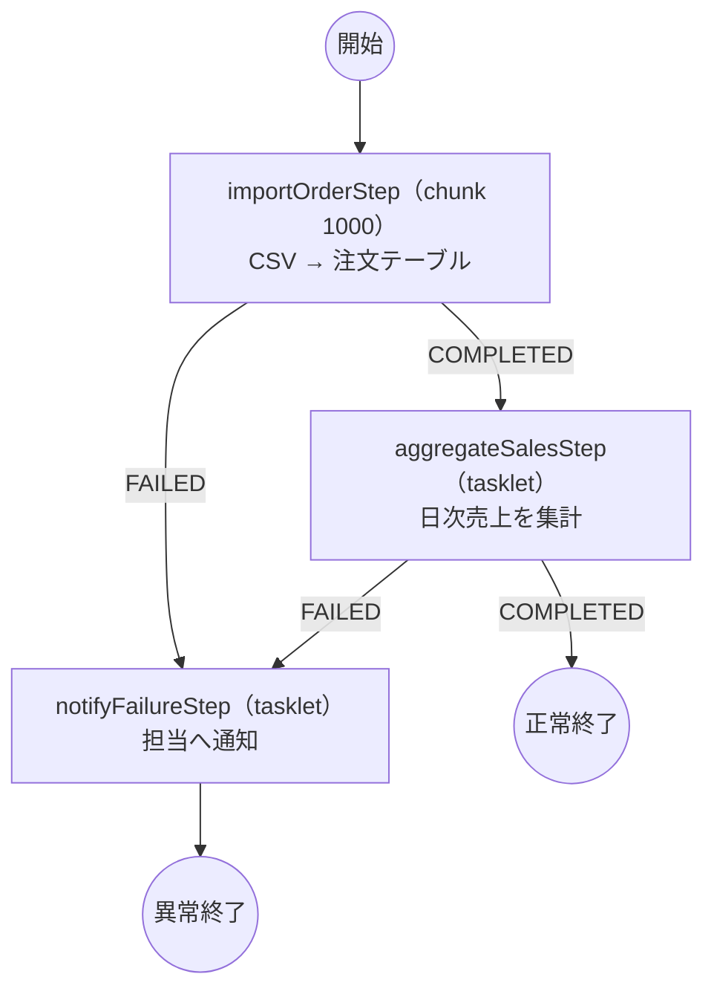

# 仕様から設計図へ（Mermaid）

## 流れ

1. 利用者が [仕様書テンプレート](batch-spec-template.md) を埋めて渡す
2. エージェントは ★ 項目の不足だけを質問する
3. [判断基準](batch-vs-boot.md) に照らし、Spring Batch か素の Spring Boot かを根拠とともに決める
4. 設計図を `docs/batch-specs/<ジョブ名>.design.md` に書き、**利用者の承認を得てから** 実装に入る
5. 実装後、設計図とコードが食い違っていないかを確かめる

## 設計図に書くこと

- 判断結果（Batch / 素の Boot）とその根拠（仕様のどの項目による判断か）
- 処理の流れ図（Mermaid の `flowchart`）
- 各ステップの表: 名前、種類（chunk / tasklet）、chunk なら件数、Reader / Processor / Writer の各クラス名と層、スキップ・リトライの方針
- chunk の Reader があれば、その作り方の2つの案（[architecture.md](architecture.md) の「chunk の Reader とリポジトリ」）と推奨案。どちらにするかを利用者に選んでもらう
- 使うクラスの一覧（層ごと）

## 図の描き方の決まり

- `flowchart TD` を使う
- ステップは四角、終了は丸、分岐は菱形で描く
- ステップの表示名は「ステップ名（種類）」とする。例: `importStep（chunk 1000）`
- 終了状態による遷移は矢印のラベルに書く（`COMPLETED`, `FAILED` など）
- 素の Spring Boot の場合も同じ記法で、`ApplicationRunner` から呼ぶ UseCase の処理順を描く

## 例（Spring Batch）

仕様: 前日の注文を CSV から取り込み、検証し、売上を集計する。不正行は 100 件まで飛ばし、失敗時は通知する。

| ステップ | 種類 | Reader | Processor | Writer | 異常時 |
|---|---|---|---|---|---|
| importOrderStep | chunk 1000 | `OrderCsvItemReader`（infrastructure） | `ImportOrderItemProcessor`（batch）→ `ImportOrderUseCase` | `OrderItemWriter`（infrastructure） | 不正行は 100 件までスキップ |
| aggregateSalesStep | tasklet | ― | `AggregateDailySalesUseCase` | ― | 失敗で通知へ |
| notifyFailureStep | tasklet | ― | `NotifyJobFailureUseCase` | ― | ― |
